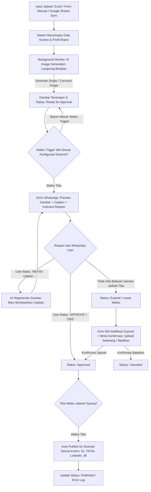

# Creator Management System - Functional Specification & Workflow Blueprint

Dokumen ini merangkum seluruh kesepakatan fungsional sistem Creator Management berbasis otomasi AI, validasi WhatsApp interaktif, dan multi-sosial media auto-publishing.

---

## 1. Core Workflow Architecture (Alur Kerja Inti)

---

## 2. Rincian Fitur & Spesifikasi Fungsional

### A. Mekanisme Input Jadwal Konten
Sistem menyediakan 3 metode input:
1. **Upload File Excel (.xlsx / .csv):**
   - Kolom yang didukung:
     - `task_name` (Nama task/konten)
     - `caption` (Deskripsi postingan)
     - `image_prompt` (Prompt AI. Mendukung format multi-gambar carousel dengan separator `||`, misal: `Prompt 1 || Prompt 2`)
     - `scheduled_at` (Waktu tanggal & jam tayang)
     - `platforms` (Target sosmed, contoh: `Instagram, TikTok, LinkedIn`)
     - `whatsapp_recipient` *(Opsional)*: Nomor HP tujuan approval. Jika kosong, fallback ke nomor default Brand Profil.
     - `brand_id / creator_name` *(Opsional)*: Mapping profil brand terkait.
2. **Input Form Manual di Dashboard:**
   - Form input interaktif untuk menambah atau mengedit baris konten satu per satu.
3. **Koneksi Google Sheets Sync:**
   - Integrasi URL Google Sheet dengan sinkronisasi terjadwal/manual 1-klik.

---

### B. Otomasi AI Image Generation
- **Timing:** Langsung digenerate di background setelah input diterima (pre-generated).
- **Format:** Mendukung single image dan multi-gambar/carousel.
- **Auto-Regenerasi Revisi:** Jika user membalas revisi, engine AI menggabungkan prompt awal + feedback revisi untuk menghasilkan output gambar baru, kemudian mengirimkannya ulang ke WA.

---

### C. WhatsApp Approval Engine & Logika Interaksi
1. **Waktu Pengiriman Pesan WA:**
   - Bersifat **konfigurasi dinamis** (bisa diatur di Pengaturan, misal: *Kirim langsung setelah gambar jadi*, atau *H-X jam / menit sebelum jadwal tayang*).
2. **Format Pesan WA yang Dikirim:**
   - Mengirim media preview gambar (single / carousel) + teks caption.
   - Disertai panduan instruksi balasan:
     > *"Balas **OKE** atau **APPROVE** untuk menyetujui postingan.*  
     > *Balas **REVISI: [catatan perubahanmu]** jika ingin gambar di-generate ulang."*
3. **Penanganan Kasus Expired (Deadline Terlewati Tanpa Respon):**
   - Jika waktu posting tiba namun belum ada balasan, sistem menandai konten sebagai `Expired/Gagal`.
   - Mengirimkan pesan WhatsApp penanganan darurat:
     > *"⚠️ Jadwal posting telah lewat tanpa persetujuan. Balas **UPLOAD** untuk posting sekarang, atau balas **LEWATKAN** untuk membatalkan."*

---

### D. Multi-Platform Social Media Publishing
- **Target Platform Dinamis:** Ditentukan per baris konten (contoh: baris A hanya `TikTok`, baris B `Instagram, LinkedIn`).
- **Penyimpanan Kredensial Multi-Brand / Multi-Kreator:**
  - Kredensial API (Instagram Meta Graph Token, TikTok API, LinkedIn API, dll) disimpan secara terisolasi per profil Brand/Kreator.
  - 1 Dashboard dapat mengelola banyak brand/klien secara independen.

---

### E. Dashboard Web Creator Management
Halaman dan fitur dashboard:
1. **Content Schedule Board & Table:**
   - Tabel pemantauan dengan badge status real-time:
     - `Draft`
     - `Generating Image`
     - `Waiting Approval (WA Sent)`
     - `Revision Requested`
     - `Approved`
     - `Publishing`
     - `Published`
     - `Expired / Action Needed`
   - Tombol manual trigger: *Force Generate*, *Resend WA*, *Manual Publish Now*, *Retry Failed*.
   - Preview visual gambar hasil generate langsung di web.
2. **Download Template Excel:** Tombol download template `.xlsx` resmi dengan format kolom yang valid.
3. **Data Source Integration:** Pengaturan link Google Sheets dan riwayat sinkronisasi.
4. **Brand & Social Media Settings:** Manajemen profil brand, nomor WhatsApp PIC, dan API Keys sosial media masing-masing.
5. **System Settings:** Pengaturan jendela waktu trigger WA (H-X jam).
