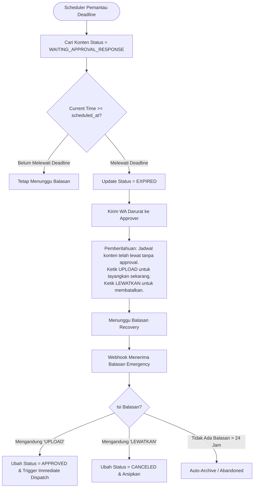
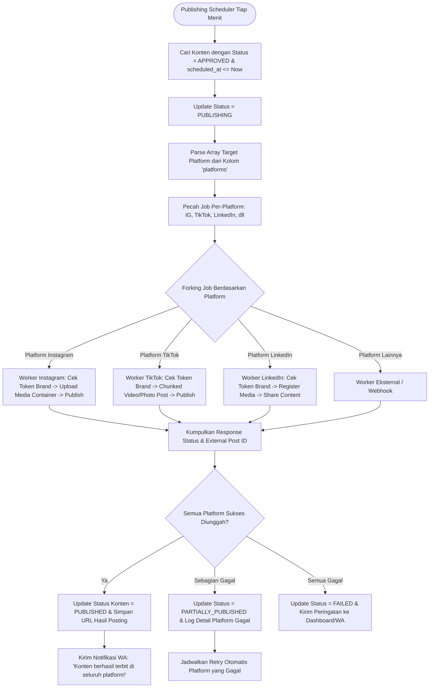
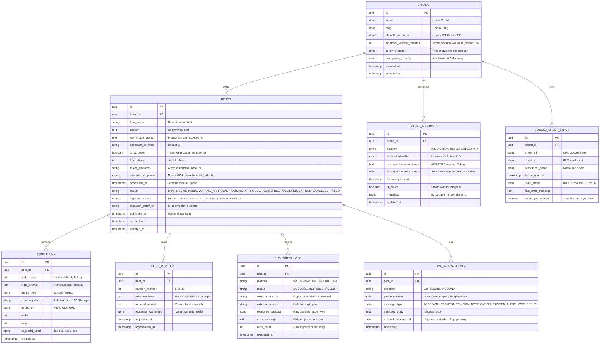

# PRODUCT REQUIREMENT DOCUMENT (PRD) & FUNCTIONAL SPECIFICATION DOCUMENT (FSD)
## System: Autonomous AI Creator Management & Omnichannel Social Media Scheduler
**Version:** 1.0.0  
**Status:** Approved for Implementation  
**Document Owner:** Senior Technical Product Architect  
**Audience:** Product Team, Frontend/Backend Engineering, QA, AI Engineers, Operations  
**Date:** October 2026  

---

## DAFTAR ISI (TABLE OF CONTENTS)
1. [EXECUTIVE SUMMARY & BUSINESS OBJECTIVES](#1-executive-summary--business-objectives)
2. [USER PERSONAS & USE CASES](#2-user-personas--use-cases)
3. [SYSTEM ARCHITECTURE & TECHNOLOGY BLUEPRINT](#3-system-architecture--technology-blueprint)
4. [COMPLETE END-TO-END FLOWCHARTS](#4-complete-end-to-end-flowcharts)
   - 4.1. Ingestion & Pre-Generation Engine Flow
   - 4.2. Dynamic WhatsApp Approval & Interactive Webhook State Machine
   - 4.3. Expiration, SLA Breach, & Recovery Sub-flow
   - 4.4. Omnichannel Dispatcher & Social Publishing Engine
5. [DETAILED FUNCTIONAL REQUIREMENTS SPECIFICATION (FRS)](#5-detailed-functional-requirements-specification-frs)
   - 5.1. Tri-Modal Data Ingestion Engine (Excel, Manual UI, Google Sheets)
   - 5.2. AI Prompt Engine & Image Generation Service (Single & Carousel)
   - 5.3. Autonomous Revision & Prompt Mutator Engine
   - 5.4. WhatsApp Conversational Interface & Gateway Bridge
   - 5.5. Social Media Integration & Publishing Service
   - 5.6. Multi-Tenant Brand Management & Workspace Isolation
6. [DATABASE ARCHITECTURE & ENTITY-RELATIONSHIP DIAGRAM (ERD)](#6-database-architecture--entity-relationship-diagram-erd)
   - 6.1. Entity-Relationship Diagram (ERD Mermaid)
   - 6.2. Comprehensive Data Dictionary & Column Specifications
7. [API CONTRACTS & WEBHOOK SPECIFICATIONS](#7-api-contracts--webhook-specifications)
   - 7.1. File Ingestion & Manual Creation Endpoints
   - 7.2. Inbound WhatsApp Webhook Payload & State Transition Logic
   - 7.3. Social Media Dispatcher Interfaces
8. [USER INTERFACE & DESIGN SYSTEM SPECIFICATIONS](#8-user-interface--design-system-specifications)
   - 8.1. Content Operations Grid (Kanban & Table Hybrid)
   - 8.2. Brand Integration & Social Credentials Vault
   - 8.3. Visual Asset Inspector & Revision Studio
9. [EDGE CASES, ERROR HANDLING & RESILIENCE STRATEGY](#9-edge-cases-error-handling--resilience-strategy)
10. [SECURITY, COMPLIANCE, AND DATA PRIVACY](#10-security-compliance-and-data-privacy)
11. [IMPLEMENTATION ROADMAP & SPRINT PHASING](#11-implementation-roadmap--sprint-phasing)

---

## 1. EXECUTIVE SUMMARY & BUSINESS OBJECTIVES

### 1.1. Problem Statement
Kreator konten, agensi digital marketing, dan brand in-house menghadapi hambatan besar (*bottlenecks*) dalam alur produksi konten:
1. **Pemisahan Alat yang Terfragmentasi**: Perencanaan dilakukan di spreadsheet (Excel/Google Sheets), pembuatan visual di tool terpisah (Midjourney/DALL-E), persetujuan manajerial via chat manual WhatsApp yang berserak, dan postingan dijadwalkan lewat platform publishing terpisah.
2. **Latensi Persetujuan (Approval Friction)**: Manajer/klien lambat membuka dashboard web untuk approval, menyebabkan jadwal posting terlewat atau konten diunggah tanpa verifikasi kualitas.
3. **Kerumitan Carousel & Revisi**: Konten carousel membutuhkan koordinasi banyak prompt gambar. Ketika ada koreksi visual, kreator harus mengulang pembuatan prompt manual dari awal.

### 1.2. The Solution: Autonomous Creator Management System
Sistem ini menyatukan seluruh mata rantai menjadi satu ekosistem otonom:
- **Tri-Modal Input**: Menerima input batch melalui Excel (.xlsx/.csv), sinkronisasi langsung Google Sheets API, atau Form Manual Web.
- **Asynchronous Instant Image Synthesis**: Background worker langsung men-generate visual AI (single image atau carousel multi-slide dengan delimiter `||`) seketika saat data masuk.
- **Interactive Conversational Approval via WhatsApp**: Sistem mengirim media visual, caption, dan tombol respon cepat ke WhatsApp approver pada jendela waktu dinamis yang dapat dikonfigurasi.
- **Self-Healing Revision Engine**: Balasan chat `REVISI: [catatan]` secara otomatis memicu AI prompt mutator untuk menghasilkan gambar baru dan mengirim chat approval ulang tanpa intervensi manual.
- **Omnichannel Target-Aware Publishing**: Setelah status berubah menjadi `APPROVED`, sistem mengunggah konten ke platform target yang didefinisikan per baris (Instagram, TikTok, LinkedIn, YouTube Shorts, X) menggunakan kredensial per-brand.

### 1.3. Success Metrics (KPIs)
- **Zero Content Drift**: 100% jadwal yang disetujui terbit tepat waktu dalam toleransi $\pm 60$ detik.
- **Approval Turnaround Time**: Reduksi waktu review dari rata-rata 4.5 jam menjadi < 15 menit melalui interaksi WhatsApp native.
- **Fault-Tolerant Resilience**: 0% duplikasi posting saat terjadi timeout atau retry berkat penerapan idempotency keys.

---

## 2. USER PERSONAS & USE CASES

| Persona | Peran | Kebutuhan Utama | Titik Sakit Utama |
|---|---|---|---|
| **Content Strategist / Planner** | Menyusun kalender konten bulanan | Upload puluhan baris jadwal via Excel atau sync Google Sheet sekali klik | Bosan memindahkan teks dari sheet ke scheduler tool satu per satu |
| **Creative Director / Client Approver** | Memvalidasi kepatuhan visual & tone-of-voice | Menyetujui atau meminta revisi gambar langsung dari HP via WhatsApp tanpa login web | Tidak mau membuka laptop/dashboard rumit hanya untuk klik "Approve" |
| **Social Media Operations Lead** | Memantau status eksekusi dan koneksi akun | Dashboard pemantauan real-time status: Draft, In-Review, Approved, Published, Expired | Khawatir postingan tayang tanpa izin atau gagal publish tanpa ada alert |
| **Agency Account Manager** | Mengelola puluhan brand klien | Isolasi akun multi-brand, pengaturan nomor WhatsApp PIC berbeda per brand/konten | Tercampurnya kredensial antar klien yang berisiko fatal |

---

## 3. SYSTEM ARCHITECTURE & TECHNOLOGY BLUEPRINT

Sistem didesain dengan prinsip **Event-Driven Microservices / Modular Monolith** berbasis antrean (queue-based asynchronous workers):

```
┌──────────────────────────────────────────────────────────────────────────────────────────────────┐
│                                       INGESTION LAYER                                            │
│   ┌─────────────────────┐       ┌──────────────────────┐        ┌────────────────────────────┐   │
│   │  Excel / CSV Upload │       │  Google Sheets Sync  │        │   Manual Dashboard UI      │   │
│   └──────────┬──────────┘       └──────────┬───────────┘        └─────────────┬──────────────┘   │
└──────────────┼─────────────────────────────┼──────────────────────────────────┼──────────────────┘
               ▼                             ▼                                  ▼                   
┌──────────────────────────────────────────────────────────────────────────────────────────────────┐
│                             API GATEWAY & ORCHESTRATION CORE                                     │
│   - Ingestion Controller & Parser (Validation, Sanitization, Delimiter Splitting)                │
│   - Multi-Tenant Resolver (Brand Context, Dynamic Settings)                                      │
│   - Content Repository & State Transition Coordinator                                            │
└──────────────┬────────────────────────────────────────────────────────────────┬──────────────────┘
               ▼                                                                ▼                   
┌──────────────────────────────────────────────┐ ┌─────────────────────────────────────────────────┐
│          ASYNCHRONOUS QUEUE BUS              │ │              PRIMARY PERSISTENCE                │
│  - Image Generation Queue                    │ │  - Relational DB (PostgreSQL / SQLite WAL)     │
│  - WhatsApp Notification & Reminder Queue    │ │  - S3 / Local MinIO Object Storage (Images)    │
│  - Social Media Publishing Queue             │ │  - Audit Trail & State Transition Logs          │
└──────────────┬───────────────────────────────┘ └─────────────────────────────────────────────────┘
               ▼                                                                                    
┌──────────────────────────────────────────────────────────────────────────────────────────────────┐
│                                   SPECIALIZED WORKERS                                            │
│  ┌─────────────────────────┐  ┌───────────────────────────┐  ┌────────────────────────────────┐  │
│  │   AI Image Generation   │  │   WhatsApp Gateway &      │  │    Omnichannel Social Media    │  │
│  │   Worker (DALL-E/Flux)  │  │   Webhook Receiver        │  │    Dispatcher (Meta/TikTok/etc)│  │
│  └─────────────────────────┘  └───────────────────────────┘  └────────────────────────────────┘  │
└──────────────────────────────────────────────────────────────────────────────────────────────────┘
```

---

## 4. COMPLETE END-TO-END FLOWCHARTS

### 4.1. Ingestion & Pre-Generation Engine Flow
Diagram ini mengilustrasikan alur sejak file dimasukkan hingga gambar AI siap direview:

```mermaid
flowchart TD
    Start([User Inisiasi Input]) --> InputType{Pilih Metode Input}
    
    InputType -->|File Excel / CSV| ReadFile[Upload File .xlsx / .csv]
    InputType -->|Google Sheets| FetchSheet[Fetch Google Sheets API via Sheet ID]
    InputType -->|Manual Web Form| ReadForm[Isi Form Single Content di Dashboard]
    
    ReadFile --> ParseEngine[Parser & Validator Kolom: task_name, caption, image_prompt, scheduled_at, platforms]
    FetchSheet --> ParseEngine
    ReadForm --> ValidateDirect[Validasi Data Form]
    
    ParseEngine --> SchemaCheck{Validitas Skema & Tanggal?}
    ValidateDirect --> SchemaCheck
    
    SchemaCheck -->|Gagal: Ada Kolom Kosong/Format Rusak| ShowError[Kembalikan Error & Log Baris Bermasalah]
    ShowError --> Stop1([Selesai / Perbaiki])
    
    SchemaCheck -->|Lolos Validasi| SaveDraft[Simpan Data ke Database: Status = DRAFT]
    SaveDraft --> DetectCarousel{Prompt Mengandung Delimiter '||'?}
    
    DetectCarousel -->|Ya| SplitPrompts[Pecah Prompt Menjadi N Sub-Tasks Carousel Slides]
    DetectCarousel -->|Tidak| SinglePrompt[Buat 1 Task Image Generation]
    
    SplitPrompts --> PushQueue[Enqueue ke AI Image Generation Worker Queue]
    SinglePrompt --> PushQueue
    
    PushQueue --> UpdateStatusGen[Update Status Konten = GENERATING_IMAGE]
    
    UpdateStatusGen --> WorkerAI[Worker Menjalankan API Image Generator]
    WorkerAI --> SaveMedia[Download Buffer & Simpan Media ke Object Storage]
    SaveMedia --> LinkMedia[Kaitkan Media IDs ke Record Content Post]
    LinkMedia --> StatusReady[Update Status Konten = WAITING_APPROVAL_WINDOW]
    StatusReady --> EndPreGen([Pre-Generation Sukses])
```

---

### 4.2. Dynamic WhatsApp Approval & Interactive Webhook State Machine
Diagram ini memperlihatkan bagaimana sistem menentukan waktu kirim WhatsApp, menerima webhook balasan pengguna, dan menangani perintah approval maupun revisi:

```mermaid
flowchart TD
    SchedulerCheck([Cron Scheduler Berjalan Tiap Menit]) --> CheckItems[Cari Konten dengan Status = WAITING_APPROVAL_WINDOW]
    CheckItems --> EvalTrigger{Current Time >= scheduled_at - brand.approval_window_minutes?}
    
    EvalTrigger -->|Belum Masuk Jendela| WaitNext[Biarkan di Status WAITING_APPROVAL_WINDOW]
    EvalTrigger -->|Sudah Masuk Jendela| ResolvePhone[Ambil Nomor WhatsApp Target]
    
    ResolvePhone --> PhoneCheck{Kolom whatsapp_recipient di baris terisi?}
    PhoneCheck -->|Terisi| UseRowPhone[Gunakan Nomor Baris Konten]
    PhoneCheck -->|Kosong| UseDefaultPhone[Gunakan Nomor Default dari Brand Profile]
    
    UseRowPhone --> DispatchWA[Kirim Pesan WA: Gambar/Carousel + Caption + Instruksi]
    UseDefaultPhone --> DispatchWA
    
    DispatchWA --> MarkWaiting[Update Status = WAITING_APPROVAL_RESPONSE & Catat wa_message_id]
    
    MarkWaiting --> InboundEvent([Approver Menerima Pesan di WhatsApp])
    InboundEvent --> UserAction[Approver Membalas Pesan di WhatsApp]
    
    UserAction --> WebhookRecv[Webhook Gateway Menerima Payload Pesan Masuk]
    WebhookRecv --> MatchMessage[Cocokkan Pengirim & Konteks Task Aktif]
    
    MatchMessage --> ParseCommand{Analisis Teks Balasan}
    
    ParseCommand -->|Mengandung 'APPROVE' / 'OKE'| HandleApprove[Update Status Konten = APPROVED]
    HandleApprove --> AckApprove[Kirim WA Konfirmasi: 'Konten disetujui & terjadwal tayang!']
    
    ParseCommand -->|Diawali 'REVISI:'| ExtractNotes[Ekstrak Catatan Revisi Setelah Prefix 'REVISI:']
    ExtractNotes --> UpdateRevise[Update Status = REVISING & Catat revision_history]
    UpdateRevise --> MutatePrompt[AI Prompt Mutator: Gabungkan Original Prompt + Feedback User]
    MutatePrompt --> RegenerateAI[Trigger AI Image Worker Generate Ulang]
    RegenerateAI --> ResendWA[Kirim Ulang Preview Gambar Baru ke WA Approver]
    ResendWA --> MarkWaiting
    
    ParseCommand -->|Format Teks Tidak Dikenali| SendHelp[Kirim Pesan Bantuan Format: 'Ketik OKE untuk approve atau REVISI: [catatan]']
```

---

### 4.3. Expiration, SLA Breach, & Recovery Sub-flow
Diagram penanganan jika waktu publikasi tiba namun approver belum memberikan keputusan:



---

### 4.4. Omnichannel Dispatcher & Social Publishing Engine
Diagram eksekusi pengunggahan konten ke jejaring sosial sesuai konfigurasi per-baris:



---

## 5. DETAILED FUNCTIONAL REQUIREMENTS SPECIFICATION (FRS)

### 5.1. Tri-Modal Data Ingestion Engine

#### 5.1.1. Ingestion File Excel / CSV
- **FR-ING-001**: Sistem harus menyediakan endpoint dan antarmuka web untuk upload file berekstensi `.xlsx`, `.xls`, dan `.csv` dengan batas maksimal ukuran file 25 MB.
- **FR-ING-002**: Sistem harus memvalidasi header kolom wajib:
  1. `task_name` (Wajib, String, 3-255 karakter)
  2. `caption` (Wajib, String, mendukung multiline / emoji)
  3. `image_prompt` (Wajib, String. Jika carousel, dipisahkan delimiter `||`)
  4. `scheduled_at` (Wajib, Format ISO `YYYY-MM-DD HH:mm` atau format standar Excel tanggal)
  5. `platforms` (Wajib, String dipisahkan koma, case-insensitive, contoh: `Instagram, TikTok, LinkedIn`)
  6. `whatsapp_recipient` (Opsional, Format nomor internasional E.164, misal: `6281234567890`)
  7. `brand_slug` atau `brand_name` (Opsional, jika kosong menggunakan brand aktif pada workspace saat ini)
- **FR-ING-003**: Sistem wajib melakukan atomicity batch processing: jika ada baris yang korup format tanggalnya, sistem memberikan laporan baris mana yang salah (misal: "Baris 7 tanggal tidak valid") tanpa menggagalkan baris lain yang valid (partial success with error report).

#### 5.1.2. Ingestion Form Manual Web Dashboard
- **FR-ING-004**: Form manual harus menyediakan kontrol interaktif:
  - Text input `Nama Konten`.
  - Rich textarea `Caption / Copywriting` dengan penghitung karakter dan preview hashtag.
  - Dynamic multi-input `Image Prompt`: User dapat menekan tombol `[+ Tambah Slide Carousel]` yang secara internal akan menggabungkan prompt dengan separator `||`.
  - Datetime picker `Jadwal Upload` dengan batasan validasi minimal 15 menit dari waktu saat ini.
  - Multi-select checkbox untuk `Target Platform` (Instagram, TikTok, LinkedIn, YouTube, X).
  - Phone input `WhatsApp PIC` (dengan bendera negara & auto-formatting).
  - Selector `Pilih Brand/Kreator`.

#### 5.1.3. Ingestion Google Sheets Integration
- **FR-ING-005**: User dapat memasukkan URL / Spreadsheet ID Google Sheets dan nama worksheet (tab).
- **FR-ING-006**: Sistem mendukung sinkronisasi manual 1-klik (*Sync Now*) dan sinkronisasi terjadwal (polling tiap 15 menit atau Google Sheets App Script Webhook trigger).
- **FR-ING-007**: Sistem harus mendeteksi duplikasi baris berdasarkan hash kombinasi `(task_name + scheduled_at + brand_id)` agar tidak terjadi pembuatan ulang data yang sudah pernah diimpor.

---

### 5.2. AI Prompt Engine & Image Generation Service

- **FR-AI-001 (Immediate Generation)**: Segera setelah data tersimpan dengan status `DRAFT`, task background job `GENERATE_IMAGE` harus otomatis di-enqueue tanpa menunggu jadwal tayang.
- **FR-AI-002 (Carousel Parsing)**: Jika kolom `image_prompt` berisi delimiter `||`, sistem harus memecah string menjadi array slide berurutan:
  - Index 0: Slide 1 (Cover)
  - Index 1: Slide 2
  - Index N: Slide N+1
- **FR-AI-003 (Parallel Synthesis)**: Generator worker harus men-generate seluruh slide carousel secara asynchronous dengan mempertahankan indeks urutan slide.
- **FR-AI-004 (Resolution & Aspect Ratio)**: Sistem mendukung konfigurasi rasio aspek per platform:
  - Default: 1:1 (Square, 1080x1080) atau 4:5 (Portrait, 1080x1350) untuk Instagram Feed.
  - 9:16 (Story/Reels, 1080x1920) jika platform adalah TikTok / Reels.
- **FR-AI-005 (Storage Persistence)**: Gambar hasil render diunduh dari temporary URL AI provider ke object storage permanen (S3/MinIO) dengan path terstruktur:
  `uploads/brands/{brand_id}/posts/{post_id}/slide_{index}_{timestamp}.webp`.

---

### 5.3. Autonomous Revision & Prompt Mutator Engine

- **FR-REV-001 (Detection)**: Sistem mendeteksi pesan masuk WhatsApp yang diawali kata kunci `REVISI:` (case-insensitive, mendukung variasi seperti `Revisi:`, `revisi -`).
- **FR-REV-002 (Prompt Mutation)**: Sistem mengambil `original_prompt` dan `revision_feedback`, kemudian memanggil AI LLM (Prompt Engineer Agent) untuk memformulasi `mutated_prompt`:
  - *System Instruction Prompt Mutator*: "Anda adalah AI art director. Perbarui prompt awal berdasarkan umpan balik koreksi pengguna tanpa menghilangkan esensi visual utama yang sudah benar."
- **FR-REV-003 (History Versioning)**: Setiap revisi harus dicatat dalam tabel `content_revisions` mencakup:
  - `revision_number` (inkremental: 1, 2, 3...)
  - `feedback_text`
  - `previous_image_url`
  - `new_image_url`
  - `mutated_prompt`
- **FR-REV-004 (Re-Dispatch Approval)**: Setelah gambar revisi selesai digenerate, sistem otomatis mengirim pesan balasan ke WhatsApp pengirim:
  > *"Gambar revisi (Versi #{N}) telah selesai digenerate! Silakan review kembali:*  
  > *(Media gambar dilampirkan)*  
  > *Ketik OKE untuk menyetujui atau REVISI: [catatan baru]."*

---

### 5.4. WhatsApp Conversational Interface & Gateway Bridge

- **FR-WA-001 (Dynamic Trigger Window)**: Waktu pengiriman pesan approval WA dihitung berdasarkan rumus:
  $$\text{trigger\_time} = \text{scheduled\_at} - \text{brand.approval\_window\_minutes}$$
  Nilai `approval_window_minutes` dapat diatur di dashboard (pilihan: 30 menit, 1 jam, 2 jam, 6 jam, 12 jam, 24 jam, atau langsung setelah gambar jadi).
- **FR-WA-002 (Message Payload Structure)**:
  - Pengiriman media tunggal atau carousel media (jika didukung API WA, atau dikirim multi-gambar berurutan).
  - Teks pesan memuat ringkasan konten:
    ```text
    🔔 [REVIEW KONTEN] - {brand_name}
    📌 Judul: {task_name}
    📅 Jadwal Tayang: {scheduled_at_formatted}
    🎯 Platform: {platforms}
    
    📝 Caption:
    "{caption_preview}"
    
    -------------------------------------------
    Ketik OKE atau APPROVE untuk menyetujui.
    Ketik REVISI: [catatan] jika perlu perbaikan.
    ```
- **FR-WA-003 (Approval Command Processing)**:
  - Kata kunci persetujuan valid: `APPROVE`, `OKE`, `OK`, `SETUJU`, `ACC`, `YES`.
  - Jika diterima, sistem membalas konfirmasi:
    > *"✅ Konten '{task_name}' berhasil DISETUJUI. Sistem akan otomatis memposting ke {platforms} pada {scheduled_at}."*
- **FR-WA-004 (Expiration Alert Handling)**:
  - Jika $\text{current\_time} \ge \text{scheduled\_at}$ dan status masih `WAITING_APPROVAL_RESPONSE`, sistem menandai konten sebagai `EXPIRED` dan mengirim pesan:
    ```text
    ⚠️ [PERINGATAN JADWAL TERLEWAT]
    Konten '{task_name}' belum sempat diapprove hingga jadwal tayang ({scheduled_at}).
    
    Pilihan tindakan:
    1. Ketik UPLOAD untuk langsung tayangkan sekarang.
    2. Ketik LEWATKAN untuk membatalkan postingan ini.
    ```

---

### 5.5. Social Media Integration & Publishing Service

- **FR-SOC-001 (Dynamic Multi-Targeting)**: Sistem membaca kolom `platforms` dan memanggil dispatcher driver yang relevan secara paralel atau sekuensial.
- **FR-SOC-002 (Supported Drivers)**:
  1. **Instagram**: Meta Graph API (Mendukung Single Photo Feed, Carousel Container Album, dan Reels).
  2. **TikTok**: TikTok Content Posting API (Direct Photo/Video Share).
  3. **LinkedIn**: LinkedIn Community Management API (UGC Posts Image/Multi-image).
  4. **Mock / Webhook Dispatcher**: Mode pengujian simulasi publishing yang mengembalikan status sukses untuk keperluan demo/testing tanpa mengonsumsi kuota API resmi.
- **FR-SOC-003 (Idempotency Key)**: Setiap request pengunggahan harus menyertakan `idempotency_key = {post_id}_{platform}_{timestamp_epoch}` untuk mencegah duplikasi konten jika terjadi network glitch/timeout.

---

### 5.6. Multi-Tenant Brand Management & Workspace Isolation

- **FR-TEN-001**: Sistem mendukung multi-brand. Setiap brand memiliki:
  - Nama Brand & Logo Brand.
  - Konfigurasi WhatsApp: Nomor default PIC, WhatsApp Gateway Provider (Cloud API / Baileys / Fonnte), dan API Token.
  - Vault Kredensial Sosial Media terenkripsi (AES-256): Instagram Access Token, Page ID, TikTok Refresh Token, LinkedIn Client Secret.
  - Default Setting: `approval_window_minutes` default, AI Style Prompt Template (contoh: "Always add photorealistic lighting, cinematic composition").
- **FR-TEN-002**: Data postingan, histori revisi, dan media terisolasi per `brand_id`.

---

## 6. DATABASE ARCHITECTURE & ENTITY-RELATIONSHIP DIAGRAM (ERD)

### 6.1. Entity-Relationship Diagram (ERD Mermaid)



---

### 6.2. Comprehensive Data Dictionary & Column Specifications

#### Tabel: `brands`
| Nama Kolom | Tipe Data | Nullable | Default | Deskripsi & Validasi |
|---|---|---|---|---|
| `id` | UUID | NO | `gen_random_uuid()` | Primary Key unik brand |
| `name` | VARCHAR(150) | NO | - | Nama Brand / Kreator / Klien |
| `slug` | VARCHAR(150) | NO | - | URL-friendly identifier, unique |
| `default_wa_phone` | VARCHAR(30) | NO | - | Format E.164 (misal: `+6281234567890`) |
| `approval_window_minutes` | INTEGER | NO | `60` | Waktu H-X menit pengiriman WA sebelum posting |
| `ai_style_preset` | TEXT | YES | `NULL` | Prompt modifier tambahan yang disisipkan otomatis |
| `wa_gateway_config` | JSONB | YES | `'{}'` | Kredensial provider WA (API key, webhook secret) |
| `created_at` | TIMESTAMP WITH TZ | NO | `NOW()` | Timestamp pembuatan |
| `updated_at` | TIMESTAMP WITH TZ | NO | `NOW()` | Timestamp pembaruan |

#### Tabel: `posts`
| Nama Kolom | Tipe Data | Nullable | Default | Deskripsi & Validasi |
|---|---|---|---|---|
| `id` | UUID | NO | `gen_random_uuid()` | Primary Key postingan |
| `brand_id` | UUID | NO | - | Foreign Key mengarah ke `brands.id` |
| `task_name` | VARCHAR(255) | NO | - | Judul tugas konten (dari kolom Excel `task_name`) |
| `caption` | TEXT | NO | - | Naskah caption postingan (dari kolom Excel `caption`) |
| `raw_image_prompt` | TEXT | NO | - | Prompt gambar asli (mendukung delimiter `||`) |
| `separator_delimiter`| VARCHAR(10) | NO | `'||'` | Karakter pemisah prompt multi-slide carousel |
| `is_carousel` | BOOLEAN | NO | `FALSE` | Otomatis di-set `TRUE` jika terdapat delimiter |
| `total_slides` | INTEGER | NO | `1` | Jumlah slide gambar terhitung |
| `target_platforms` | TEXT[] | NO | - | Array platform target, contoh: `{"instagram","tiktok"}` |
| `override_wa_phone` | VARCHAR(30) | YES | `NULL` | Nomor WA khusus jika baris Excel mengisinya |
| `scheduled_at` | TIMESTAMP WITH TZ | NO | - | Waktu rencana tayang konten |
| `status` | VARCHAR(40) | NO | `'DRAFT'` | Enum: `DRAFT`, `GENERATING`, `WAITING_APPROVAL_WINDOW`, `WAITING_APPROVAL_RESPONSE`, `REVISING`, `APPROVED`, `PUBLISHING`, `PUBLISHED`, `EXPIRED`, `CANCELED`, `FAILED` |
| `ingestion_source` | VARCHAR(30) | NO | `'EXCEL_UPLOAD'` | `EXCEL_UPLOAD`, `MANUAL_FORM`, `GOOGLE_SHEETS` |
| `ingestion_batch_id` | UUID | YES | `NULL` | ID batch jika diunggah bersamaan dalam satu file |
| `published_at` | TIMESTAMP WITH TZ | YES | `NULL` | Waktu aktual saat seluruh platform sukses terbit |
| `created_at` | TIMESTAMP WITH TZ | NO | `NOW()` | Timestamp baris dibuat |
| `updated_at` | TIMESTAMP WITH TZ | NO | `NOW()` | Timestamp baris diperbarui |

#### Tabel: `post_media`
| Nama Kolom | Tipe Data | Nullable | Default | Deskripsi & Validasi |
|---|---|---|---|---|
| `id` | UUID | NO | `gen_random_uuid()` | Primary Key aset media |
| `post_id` | UUID | NO | - | Foreign Key ke `posts.id` (ON DELETE CASCADE) |
| `slide_index` | INTEGER | NO | `0` | Urutan indeks slide: 0 = Slide 1 / Cover, 1 = Slide 2 |
| `slide_prompt` | TEXT | NO | - | Teks prompt khusus untuk potongan slide ini |
| `media_type` | VARCHAR(20) | NO | `'IMAGE'` | `IMAGE` atau `VIDEO` |
| `storage_path` | TEXT | NO | - | Path file di storage bucket lokal/S3 |
| `public_url` | TEXT | NO | - | URL publik yang dapat diakses gateway WhatsApp |
| `width` | INTEGER | YES | `1080` | Lebar resolusi dalam pixel |
| `height` | INTEGER | YES | `1080` | Tinggi resolusi dalam pixel |
| `ai_model_used` | VARCHAR(50) | YES | `'flux-schnell'` | Nama engine AI model yang merender aset |
| `created_at` | TIMESTAMP WITH TZ | NO | `NOW()` | Timestamp render |

#### Tabel: `post_revisions`
| Nama Kolom | Tipe Data | Nullable | Default | Deskripsi & Validasi |
|---|---|---|---|---|
| `id` | UUID | NO | `gen_random_uuid()` | Primary Key log revisi |
| `post_id` | UUID | NO | - | Foreign Key ke `posts.id` |
| `revision_number` | INTEGER | NO | `1` | Hitungan revisi ke-berapa |
| `user_feedback` | TEXT | NO | - | Catatan revisi yang diketik user di WhatsApp |
| `mutated_prompt` | TEXT | NO | - | Prompt yang dimodifikasi oleh AI setelah masukan |
| `requester_wa_phone` | VARCHAR(30) | NO | - | Nomor WhatsApp yang meminta revisi |
| `requested_at` | TIMESTAMP WITH TZ | NO | `NOW()` | Waktu permintaan revisi masuk |
| `regenerated_at` | TIMESTAMP WITH TZ | YES | `NULL` | Waktu gambar baru selesai diproduksi |

#### Tabel: `publishing_logs`
| Nama Kolom | Tipe Data | Nullable | Default | Deskripsi & Validasi |
|---|---|---|---|---|
| `id` | UUID | NO | `gen_random_uuid()` | Primary Key catatan log publish |
| `post_id` | UUID | NO | - | Foreign Key ke `posts.id` |
| `platform` | VARCHAR(30) | NO | - | `INSTAGRAM`, `TIKTOK`, `LINKEDIN`, dll |
| `status` | VARCHAR(20) | NO | `'PENDING'` | `SUCCESS`, `FAILED`, `RETRYING` |
| `external_post_id` | VARCHAR(255) | YES | `NULL` | ID resmi postingan di platform sosmed |
| `external_post_url` | TEXT | YES | `NULL` | Tautan langsung menuju postingan yang live |
| `response_payload` | JSONB | YES | `'{}'` | Raw JSON response dari API sosmed |
| `error_message` | TEXT | YES | `NULL` | Pesan error lengkap jika gagal tayang |
| `retry_count` | INTEGER | NO | `0` | Berapa kali sudah dilakukan retry otomatis |
| `executed_at` | TIMESTAMP WITH TZ | NO | `NOW()` | Timestamp eksekusi |

---

## 7. API CONTRACTS & WEBHOOK SPECIFICATIONS

### 7.1. File Ingestion & Manual Creation Endpoints

#### Endpoint: `POST /api/v1/posts/upload-excel`
- **Content-Type**: `multipart/form-data`
- **Request Body**:
  - `file`: Binary file (.xlsx / .csv)
  - `brand_id`: UUID (Opsional, fallback ke brand aktif)
- **Response (200 OK)**:
```json
{
  "success": true,
  "batch_id": "8f3e2b14-9988-4c2f-8d9b-a3e26f1c4912",
  "total_rows_parsed": 12,
  "successful_rows": 12,
  "failed_rows": 0,
  "items": [
    {
      "id": "e4b1a8d2-1111-4f5c-8901-123456789abc",
      "task_name": "Peluncuran Produk X",
      "is_carousel": true,
      "total_slides": 3,
      "scheduled_at": "2026-10-10T10:00:00Z",
      "status": "GENERATING"
    }
  ],
  "errors": []
}
```

#### Endpoint: `POST /api/v1/posts/manual`
- **Content-Type**: `application/json`
- **Request Body**:
```json
{
  "brand_id": "a1b2c3d4-e5f6-7890-abcd-ef1234567890",
  "task_name": "Tips Mengelola Waktu Kreator",
  "caption": "Pernah merasa 24 jam tidak cukup? Ini 3 tips rahasianya! #creatorlife #productivity",
  "image_prompts": [
    "A clean modern desk setup with aesthetic laptop and coffee cup, warm cinematic morning light",
    "Close up of a structured digital daily planner on iPad with soft pastel aesthetic"
  ],
  "scheduled_at": "2026-10-12T14:30:00Z",
  "target_platforms": ["instagram", "tiktok"],
  "whatsapp_recipient": "+6281298765432"
}
```

---

### 7.2. Inbound WhatsApp Webhook Payload & State Transition Logic

#### Endpoint: `POST /api/v1/webhooks/whatsapp`
- **Header**: `X-Hub-Signature-256` atau `Authorization: Bearer <WEBHOOK_SECRET>`
- **Payload Struktur Standar (Normalisasi)**:
```json
{
  "event": "messages.upsert",
  "data": {
    "from": "6281298765432@s.whatsapp.net",
    "sender_phone": "+6281298765432",
    "message_id": "WAMID.ABGG345123987",
    "timestamp": 1791284520,
    "message_type": "text",
    "text": "REVISI: Tolong buat latarnya jangan terlalu gelap, ganti dengan suasana kafe modern."
  }
}
```

#### Parser State Transition:
1. **Sanitize Text**: Trim spasi dan uppercase untuk kata awal.
2. **Regex Patterns**:
   - Persetujuan: `/^(APPROVE|OKE|OK|SETUJU|ACC|YES)\b/i`
   - Revisi: `/^REVISI\s*[:\-]\s*(.+)/i`
   - Recovery Upload: `/^UPLOAD\b/i`
   - Recovery Batalkan: `/^LEWATKAN\b/i`
3. **Lookup Active Post**:
   Query:
   ```sql
   SELECT * FROM posts 
   WHERE (override_wa_phone = :phone OR brand_id IN (SELECT id FROM brands WHERE default_wa_phone = :phone))
     AND status IN ('WAITING_APPROVAL_RESPONSE', 'EXPIRED')
   ORDER BY scheduled_at ASC 
   LIMIT 1;
   ```
4. **Mutasi Data Sesuai Hasil Regex**:
   - Jika `APPROVE`: Mutasi status $\rightarrow$ `APPROVED`.
   - Jika `REVISI`: Insert ke `post_revisions`, mutasi status $\rightarrow$ `REVISING`, enqueue `REGENERATE_IMAGE_JOB`.
   - Jika `UPLOAD`: Mutasi status $\rightarrow$ `APPROVED`, enqueue `PUBLISH_NOW_JOB`.
   - Jika `LEWATKAN`: Mutasi status $\rightarrow$ `CANCELED`.

---

## 8. USER INTERFACE & DESIGN SYSTEM SPECIFICATIONS

### 8.1. Content Operations Grid (Kanban & Table Hybrid)
- **Top Bar**:
  - Brand Switcher Dropdown (Switch antar brand).
  - Tombol Utama `[+ Konten Baru]` (Buka modal input manual).
  - Tombol `[Upload Excel / CSV]` dengan drag-and-drop zone.
  - Tombol `[Download Template Excel]` (Mengunduh file `.xlsx` dengan petunjuk & header siap pakai).
  - Tombol `[Sync Google Sheets]`.
- **Status Filter Badges**:
  - `Semua`, `Draft`, `Generating`, `Waiting Approval`, `Approved`, `Published`, `Revising`, `Expired / Action Needed`.
- **Kolom Tabel Interaktif**:
  1. **Thumbnail Preview**: Gambar utama (bisa di-hover untuk preview zoom; jika carousel terdapat badge `1/3` yang bisa diklik untuk membuka modal slider).
  2. **Info Tugas**: Judul konten + cuplikan caption + platform icons (logo Instagram, TikTok, LinkedIn berwarna).
  3. **Jadwal & Target**: Format tanggal lokal + badge countdown waktu menuju jadwal.
  4. **WhatsApp PIC**: Nomor tujuan review + status pesan (Terkirim / Terbaca / Menunggu).
  5. **Status Badge**:
     - `WAITING_APPROVAL_RESPONSE`: Kuning berkedip lembut (*Pulsing amber*).
     - `APPROVED`: Hijau stabil (*Emerald green*).
     - `PUBLISHED`: Biru (*Brand blue*).
     - `EXPIRED`: Merah (*Rose red*).
  6. **Aksi Cepat (Quick Actions)**:
     - Tombol `[Force Generate]` (Jika render macet).
     - Tombol `[Resend WA]` (Kirim ulang chat approval).
     - Tombol `[Publish Now]` (Bypass jadwal untuk segera posting).
     - Tombol `[Edit Prompt / Manual Review]`.

---

### 8.2. Brand Integration & Social Credentials Vault
- Halaman pengaturan terisolasi per brand:
  - **Tab WhatsApp**: Konfigurasi gateway (API Key, Webhook URL yang harus disalin ke dashboard gateway WA, uji coba kirim pesan test).
  - **Tab Social Media Accounts**:
    - Tombol *Connect Instagram* (OAuth Graph API).
    - Tombol *Connect TikTok* (OAuth TikTok Business).
    - Tombol *Connect LinkedIn* (OAuth LinkedIn API).
    - Mode Switch: *Live API* vs *Simulation Mock Mode* (untuk demo tanpa token).
  - **Tab Automation Timing**:
    - Slider pemilihan `Jendela Waktu Approval WA`: Pilihan [30m, 1j, 2j, 6j, 12j, 24j, Langsung].

---

## 9. EDGE CASES, ERROR HANDLING & RESILIENCE STRATEGY

| Edge Case | Potensi Risiko | Solusi & Mekanisme Pertahanan Sistem |
|---|---|---|
| **API AI Down / Timeout saat Generate Gambar** | Postingan macet di status `GENERATING` | Sistem menerapkan Exponential Backoff Retry (maksimal 3 kali). Jika gagal permanen, status berubah menjadi `FAILED_GENERATION`, dan alert muncul di dashboard agar user dapat memilih generate ulang atau upload gambar manual. |
| **Approver Mengetik Teks Acak di WhatsApp** | Webhook bingung menafsirkan perintah | Sistem mengirimkan respon balasan pemandu otomatis: *"Maaf, format tidak dikenali. Balas **OKE** untuk menyetujui, atau **REVISI: [catatan]** untuk mengubah gambar."* |
| **Banyak Postingan Menunggu Approval dari 1 Nomor yang Sama** | Konteks ambigu saat user membalas "OKE" | Sistem selalu menautkan balasan ke postingan dengan jadwal paling dekat yang berstatus `WAITING_APPROVAL_RESPONSE`. Jika terdapat $> 1$ postingan aktif di waktu bersamaan, sistem menyertakan kode referensi task (contoh: *"Balas OKE #A1 untuk Task A, atau OKE #B2 untuk Task B"*). |
| **Koneksi Sosmed Token Expired saat Jadwal Publish Tiba** | Gagal posting pada jam tayang | Sistem menjalankan daily background check token expiration. Jika token kadaluarsa saat jam publish, sistem menandai status `FAILED_TOKEN_EXPIRED` dan langsung mengirim peringatan darurat ke WhatsApp pengelola brand untuk re-login. |
| **File Excel Mengandung Rumus Rusak / Format Cell Tidak Standar** | Crash saat parsing | File parser membersihkan formula dan hanya membaca calculated string values. Baris yang memiliki error cell diisolasi ke dalam log kesalahan tanpa menghentikan parsing baris lainnya. |

---

## 10. SECURITY, COMPLIANCE, AND DATA PRIVACY

1. **Enkripsi Kredensial Sosial Media**: Seluruh Access Token dan Refresh Token disimpan dalam database menggunakan enkripsi simetris **AES-256-GCM** dengan Master Key yang diambil dari environment variables yang aman.
2. **Webhook Verification**: Setiap webhook yang masuk dari WhatsApp Gateway wajib divalidasi tanda tangannya (HMAC-SHA256 signature) untuk mencegah request pemalsuan dari pihak luar (*spoofing*).
3. **Pemberian Hak Akses (RBAC)**: Dashboard membedakan hak akses antara *Super Admin* (akses seluruh brand) dan *Brand Manager* (hanya dapat melihat data brand miliknya).
4. **Audit Trail**: Seluruh tindakan persetujuan via WhatsApp dicatat secara abadi di tabel `wa_interactions` lengkap dengan nomor pengirim, timestamp presisi milidetik, dan isi pesan sebagai bukti persetujuan legalitas konten.

---

## 11. IMPLEMENTATION ROADMAP & SPRINT PHASING

- **Sprint 1: Database, Domain Entities & Ingestion Foundation**
  - Setup skema DB PostgreSQL/SQLite, UUID, dan migration scripts.
  - Implementasi parser Excel (.xlsx) dengan delimiter `||` untuk carousel.
  - Form manual input konten di dashboard.
- **Sprint 2: AI Generation Service & Storage Bucket**
  - Integrasi worker generator gambar AI (mendukung single & multi-slide).
  - Background worker queue (BullMQ / internal async queue).
  - Object storage upload dan preview thumbnail di UI web.
- **Sprint 3: WhatsApp Gateway Integration & State Machine**
  - Integrasi webhook pesan masuk dan pengiriman pesan template media via WA Gateway.
  - Implementasi State Machine: Approval, Revisi Otomatis (Prompt Mutator), dan Alert Expired.
- **Sprint 4: Social Media Publishing Engine & Multi-Brand Vault**
  - Modul integrasi Meta Instagram Graph API, TikTok, dan LinkedIn.
  - Simulator / Mock publisher untuk testing alur end-to-end tanpa batasan API kuota.
  - Halaman konfigurasi profil multi-brand.
- **Sprint 5: End-to-End Testing, Hardening & Deployment**
  - Stress testing batch upload Excel 100+ baris.
  - Uji ketahanan edge cases WhatsApp balasan typo.
  - Final polish dashboard UI & dokumentasi serah terima tim.
